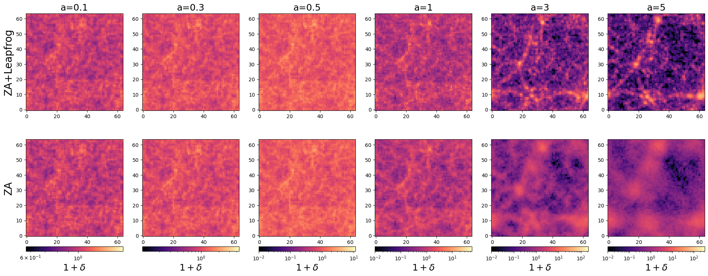
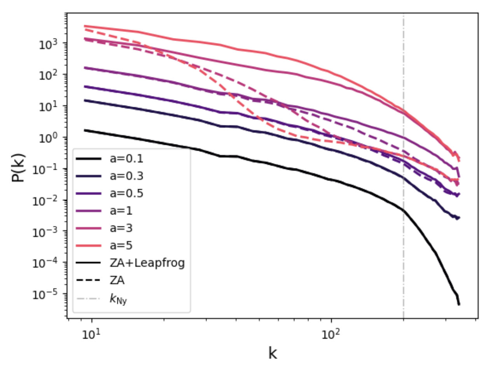

# 3D N-Body Simulations and the Zel'dovich Approximation

**Final project — Course: Cosmic Structures: Theory, Numerics, and Statistics**  
Institute for Astrophysics, University of Vienna — July 2026

Prof. Oliver Hahn & Dr. Thomas Flöss

---

## Overview

In this work, a simple N-body simulation code is implemented using Zel'dovich-approximation (ZA) initial conditions and a symplectic leapfrog integrator with gravitational acceleration computed via the non-uniform fast Fourier transform (NUFFT). The goal is to analyze the difference between the full N-body evolution and the pure Zel'dovich-approximation evolution of a Gaussian random field over time and to identify the scales and epochs at which the Zel'dovich approximation breaks down and the full non-linear dynamics become necessary to correctly capture structure growth.

  

  <em>Evolution of an initial Gaussian field set up with L = 1 and N = 64 for time a ∈ [0.1, 0.3, 0.5, 1, 3, 5]. The left column shows the ZA+Leapfrog evolution, the right column shows the pure ZA evolution. Points are coloured by 1+δ.</em>

The two solutions agree closely at early times but diverge after shell-crossing. The leapfrog integrator produces well-defined halos clustered along filaments, while particles in the ZA case remain significantly more diffuse — the Zel'dovich approximation applies no gravitational force after the initial displacement is set and particles simply continue to stream along their initial linear trajectories. This is confirmed quantitatively by the evolution of the standard deviation of the density field, which grows much more strongly for the leapfrog integrator after shell-crossing, and by the power spectrum, which shows that ZA fails to reproduce power at small scales as soon as they become non-linear, with the discrepancy progressively extending to larger scales as time progresses.

  

  <em>Evolution of the power spectrum with increasing scale factor a for
the ZA+Leapfrog simulation (solid lines) and the pure ZA simulation (dashed
lines). The Nyquist frequency is marked with a gray dash-dotted line.</em>

The full methods, results and discussion are written up in the final report: [`Final_CosmicStructures_Einramhof.pdf`](Final_CosmicStructures_Einramhof.pdf).

